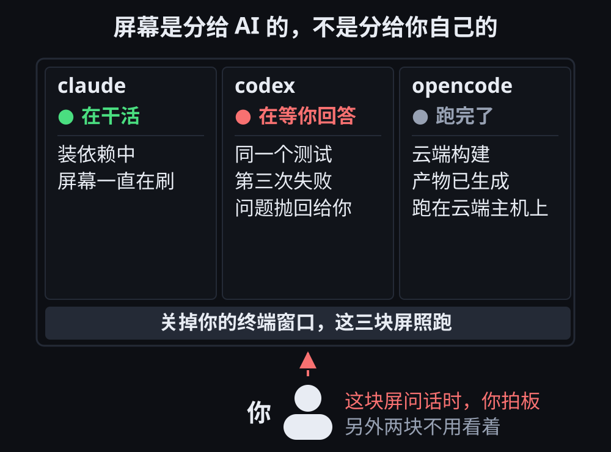

# 第 1 章 · 一个屏幕开好几块，各跑各的

> © 2026 xiaomijituan · 正文 CC BY 4.0，代码与数据 MIT · 原仓库 https://github.com/xiaomijituan/agent-machine-room-handbook

**要点**：第 1 章只讲一件事——**把活放进 tmux 之后，你关掉终端窗口，活还在干。**

本章所有命令和输出都在一台 Ubuntu 22.04 的云端沙箱上真实跑出（tmux 版本 3.2a），不是抄文档。每一次真实输出后面都注明了原始记录的位置。

## 第 1 章针对的麻烦

你让三个 AI 同时帮忙干活：一个在装依赖，一个在改代码，一个在跑测试。

接下来的麻烦有两类：

- 屏幕只有一块。三个终端窗口来回切换时，切到第三个窗口，就会忘记第一个窗口里跑到哪一步。
- 更严重的是，你合上笔记本、关掉终端窗口或者 ssh 断线一次，**正在运行的内容就会全部消失**，回来只能重跑。

网上讲 tmux 的文章，绝大多数讲的是怎样多开终端方便自己。第 1 章的安排相反：**屏幕是分给 AI 的，不是分给你自己的。** 给每个 AI 一块屏幕，然后就可以走开。

"屏幕分给 AI"是第 1 章的关键。下面这张图给出三块屏的状态行——同一时刻只有一块屏在等你拍板，另外两块不需要人看着。



## 三分钟上手

上手只需要三条命令，我们现在就敲：

```bash
tmux                      # 进去一块新屏幕
tmux ls                   # 看看你有几块
tmux new -s ai-1 -d       # 不开屏，直接在背后建一个，起名叫 ai-1
```

第一条会把你带进一个新会话（tmux 里叫 session，就是"一个能长期活着的工作台"）。界面几乎没变，只是最下面多了一条状态栏。

离开屏幕的操作是先按 `Ctrl-b` 松开、再按 `d`，这叫**离开**（detach）——人走了，会话还在运行。

回来时敲 `tmux attach` 重新接入屏幕，这叫**回来**（attach）。

## 核心对照实验：关掉终端窗口之后进程是否继续运行

这是全章唯一的重点，所以我们做了一次对照实验：同样一个每秒写一行的程序，一个放进 tmux，一个不放；然后用同一个办法，把两个程序各自的"终端窗口"都掐掉。

**掐断的方式**：我们无法真的去点击一个窗口，所以用 `script` 造一个假终端，再用 `timeout 3` 在三秒后把假终端杀掉。退出码 `124` 就是"被 timeout 杀了"的记号。这一做法在效果上等同于关闭终端窗口——窗口没了，系统会给窗口里的进程发一个"挂断信号"。

### 放进 tmux 的一组

我们先建一个会话，让会话里的循环每秒往 `/data/desk5.log` 写一行：

```bash
tmux new -s desk5 -d 'for i in $(seq 1 120); do echo tick $i >> /data/desk5.log; sleep 1; done'
```

随后我们接上去看三秒，再把终端掐掉：

```bash
timeout 3 script -qec 'tmux attach -t desk5' /dev/null
```

输出末尾是：

```
Session terminated, killing shell... ...killed.
```

终端已经关闭。我们接着查看会话和进程：

```bash
$ tmux ls
desk5: 1 windows (created Tue Oct  6 16:33:26 2026)

$ wc -l /data/desk5.log
6 /data/desk5.log

$ sleep 5

$ wc -l /data/desk5.log
11 /data/desk5.log

$ ps -ef | grep 'seq 1 120' | grep -v grep
root   139   1  0 16:33 ?    00:00:00 tmux new -s desk5 -d for i in $(seq 1 120); ...
root   140 139  0 16:33 pts/0 00:00:00 bash -c for i in $(seq 1 120); ...
```

**终端死了，会话还在，日志从 6 行涨到 11 行，两条进程都活着。**

（原始记录：`evidence/tmux-evidence-part3.md` 第 2 节。那段掐断前的输出里还能看到 tmux 的状态栏 `[desk5] 0:bash*`，说明真的挂上去过。）

### 没有放进 tmux 的一组

同一个假终端、同一个三秒掐断，区别只是这里面没有 tmux：

```bash
timeout 3 script -qec 'bash -c "for i in \$(seq 1 60); do echo y >> /data/plain2.log; sleep 1; done"' /dev/null
```

结果：

```
Session terminated, killing shell... ...killed.

$ ps -ef | grep 'seq 1 60' | grep -v grep
（什么都没有，退出码 1）

$ wc -l /data/plain2.log
3 /data/plain2.log

$ sleep 5

$ wc -l /data/plain2.log
3 /data/plain2.log
```

**进程结束了，行数卡在 3，不再增长。**

这就是 tmux 存在的意义：tmux 把"活"从终端窗口里拿出来，交给背后一个叫 **tmux 服务器**的进程管理。终端窗口只是一块屏幕的临时观众；观众离场，会话里的进程照旧运行。

### 用 `&` 丢后台与用 tmux，解决的不是同一类问题

看到这儿你会想问：我不用 tmux，在命令后面加一个 `&`，让命令到后台跑，行不行？

**`&` 的作用**：`&` 的意思是"这条命令别占着屏幕，跑到后面去"。加上 `&` 之后，你可以继续敲别的命令。

**`&` 有一个弱点**：加了 `&` 的命令，**仍然归当前的终端窗口管**。窗口一关，系统会给窗口里所有命令发一个"该走了"的信号（术语叫挂断信号）。后台命令照样收到挂断信号，一起结束。

**我们的实测能不能证明这一弱点？不能直接证明。** 实测直接证明的是另一半：**不在 tmux 里的命令，所属的终端被掐掉，那条命令就死了**。这一条的证据在开头那组"放进 tmux / 没放进 tmux"的对照实验里。

**那为什么另一次实测里，加了 `&` 的命令活下来了？**

```
$ ps -ef | grep 'seq 1 60' | grep -v grep
root   206   1  0 16:15 ?   00:00:00 bash -c for i in $(seq 1 60); ...
#                 ↑ 这个 1 是"上级进程"的编号
```

从输出可以看到，那条命令的**上级进程编号是 1**（术语叫父进程，指"谁把这条命令生出来"；1 号是机器上最早启动的那个总管家进程，所有失去上级的进程最后都归它）。上级已经变成 1 号，说明原来那个 shell 早就退出了。

**据此推出来的解释是**：云端沙箱执行命令的方式，是每条命令配一个全新的 shell。命令一跑完 shell 就退出，所以**从头到尾不存在"终端窗口"**——既然没有窗口被关掉，也就没人发"该走了"的信号。那条 `&` 命令只是恰好活着，并不是 `&` 本身扛住了关窗口。

**记住两类需求的区别**：

| 你想解决的事                                         | 该用什么        |
| ---------------------------------------------------- | --------------- |
| "这条命令别占着屏幕，我还要敲别的"                   | 用 `&` 丢后台   |
| "我关掉窗口、合上笔记本、ssh 断了，这条命令还得活着" | **只能用 tmux** |

你要的是第二件事。`&` 给不了。

## 一块屏幕切给三个 AI

给三个 AI 各建一个会话，一个名字对应一个 AI：

```bash
tmux new -s ai-a -d
tmux new -s ai-b -d
tmux new -s ai-c -d
```

下面两条命令分别列出所有会话，以及每块屏上正在运行的程序：

```bash
$ tmux ls
ai-a: 1 windows (created Tue Oct  6 15:00:11 2026)
ai-b: 1 windows (created Tue Oct  6 15:00:11 2026)
ai-c: 1 windows (created Tue Oct  6 15:00:11 2026)
desk2: 1 windows (created Tue Oct  6 14:59:59 2026)

$ tmux list-panes -a -F '#{session_name} #{window_index} #{pane_index} #{pane_current_command}'
ai-a 0 0 bash
ai-b 0 0 bash
ai-c 0 0 bash
desk2 0 0 bash
```

想把 `ai-b` 的屏幕切成两块，敲：

```bash
tmux split-window -t ai-b
```

```bash
$ tmux list-panes -t ai-b -F '#{pane_index} #{pane_current_command}'
0 bash
1 bash
```

**每一块小屏幕（tmux 里叫 pane，指一个会话窗口里切出来的独立画面）就是一个独立的位置。** 你可以让一块跑测试、一块盯日志、一块等待下一条命令；三个 AI 各占一块时，一屏之内就能看全。

（原始记录：`evidence/tmux-evidence.md` 第 5 节。）

## 三个动作的分工

三个动作最容易混淆，而混淆的代价要到内容丢失之后才显现。

| 你做的事             | 命令                                   | 里面的活会怎样       |
| -------------------- | -------------------------------------- | -------------------- |
| 离开                 | 按 `Ctrl-b` 然后 `d`，或 `tmux detach` | **继续活着**         |
| 杀掉一个会话         | `tmux kill-session -t 名字`            | **一起被杀掉**       |
| 关掉整个 tmux 服务器 | `tmux kill-server`                     | **全部会话一起没了** |

第二条我们专门验过。杀掉 `desk1` 会话之后：

```bash
$ tmux ls
no server running on /tmp/tmux-0/default

$ ps -ef | grep 'sleep 600' | grep -v grep
（空，退出码 1）

$ cat /data/desk1-done.txt
cat: /data/desk1-done.txt: No such file or directory
```

`desk1` 会话原本要在跑完之后写一个 `desk1-done.txt` 文件。文件从来没出现过——**因为整条命令链被一起掐死了**，那句写文件的命令没有机会执行。

（原始记录：`evidence/tmux-evidence.md` 第 3 节，`evidence/tmux-evidence-part2.md` 第 2 节，两次独立复现。）

所以：**想让会话里的活继续干，用离开；想让会话彻底消失，才用杀会话。** 不要把"我关掉了窗口"当成"我杀掉了会话"。

## 意外发现：没有真终端就无法接回会话

几乎所有 tmux 教程都不讲这一点，但你一定会遇到。

我们在一个没有真终端的环境里（云端沙箱，命令逐条独立执行，本就没有窗口）尝试 `tmux attach`：

```bash
$ tmux attach-session -t desk4
open terminal failed: not a terminal

$ tmux detach-client -t desk4
can't find client: desk4
```

**报错原文就是这样。**

报错的意思是：没有真终端时无法接入会话。问题不在命令写法，而在没有真终端的环境里不存在可以显示的屏幕。

CI 流水线、脚本、别人给的临时沙箱，这三类环境都会遇到同样的限制。这时不要反复尝试 `attach`，改用下面几条命令查看状态：

```bash
tmux ls                                    # 有哪些会话
tmux list-panes -a -F '#{pane_index} #{pane_current_command}'   # 每块屏在跑什么
tmux capture-pane -t desk5 -p              # 把那块屏幕上的文字抓下来
tmux send-keys -t ai-a 'npm test' Enter    # 不接屏幕，直接往里敲
```

最后一句是重点：**不需要接上屏幕，也能指挥会话里的活。** `send-keys` 的作用相当于隔着门往里喊话。

（原始记录：`evidence/tmux-evidence-part2.md` 第 1.2 节。）

## 你大概率会遇到的一个报错

开头那组"放进 tmux / 没放进 tmux"的对照实验，第一次跑出来是：

```
bash: -c: line 2: syntax error near unexpected token `2'
```

原因是 `$(seq 1 60)` 被**提前展开**了。命令要穿过 `script` 那一层 shell，`script` 内部那层 shell 先把 `$(...)` 算成了一个数字，传下去的已经不是你以为的那句。

修法：把 `$` 转义。

```bash
script -qec 'bash -c "for i in \$(seq 1 60); do ... done"' /dev/null
#                          ↑ 加了反斜杠
```

`$(...)` 被外面那层 shell 提前算掉——这类错误值得记住，因为很多场合都会再遇到。只要一条命令要再过一层 shell——比如 `ssh`、`tmux new -d`、`script`、`docker exec`——就要先确认 **`$(...)` 会在哪一层被算掉**。

（原始记录：`evidence/tmux-evidence-part3.md` 第 3 节和第 3R 节，失败和改好后的两次都在。）

## 附带现象：僵尸进程

`tmux kill-server` 之后，`ps` 的输出里会留下下面两行记录：

```
root   173   1  0 14:59 ?   00:00:00 [tmux: server] <defunct>
root   219   1  0 14:59 ?   00:00:00 [tmux: server] <defunct>
```

`<defunct>` 就是**僵尸进程**：进程已经退出，但退出记录还没有被上级回收。容器和沙箱里这类记录常见，因为负责回收的 1 号进程不一定执行了回收。

遇到僵尸进程**不需要慌张，也不必处理**：僵尸进程不占用内存，只占用一条进程记录。

（原始记录：`evidence/tmux-evidence.md` 第 5.2 节。）

## 三句话带走

1. **屏幕是给 AI 分的，不是给你自己的。** 一个 AI 一个会话，或者一个 AI 一块屏幕，只管派活和看结果。
2. **离开和杀掉是两回事。** `Ctrl-b d` 走了，会话里的活照跑；`kill-session` 才是真杀。
3. **没有真终端就别 attach。** 用 `send-keys` 隔着门喊话，用 `capture-pane` 看结果。

## 如何自行复现

书里的结论都在一台云端 Ubuntu 上测过。你在自己的机器上复现，三条命令就够：

```bash
tmux new -s test -d 'for i in $(seq 1 30); do echo $i >> /tmp/t.log; sleep 1; done'
tmux ls
wc -l /tmp/t.log        # 隔几秒再敲一次，数字一直在涨
```

然后把敲这三条命令的终端窗口直接关掉，重开一个窗口敲 `tmux ls`，`test` 还在——第 1 章的全部承诺就是这一条。

---

### 证据与原始记录

所有输出的原始文件在 `evidence/` 目录：`tmux-evidence.md`（基础行为）、`tmux-evidence-part2.md`（失败的一轮）、`tmux-evidence-part3.md`（对照实验）。机器、系统版本、软件版本、测量方法、**哪些没测到**，都写在 `verify.md` 里。

### 配套文件与提醒

- **可以交互操作的部分**：第 1 章配了一份剧本（`scenario.json`）。在仓库根目录执行 `npm run serve:site`，然后打开 <http://127.0.0.1:5280/site/chapter.html?chapter=01-one-screen-many-ai>：页面会把这份剧本交给嵌在下面的模拟器，机房会变成剧本里描述的那三块屏幕，主机一栏是 `laptop` 和 `cloud`。如果页面提示没有成功，就把 `scenario.json` 的全文复制下来，粘贴进模拟器的「剧本库」再按「导入」——那是不走注入的另一条入口，校验规则完全一样。
- **对拍**：`reference.jsonl` 是第 1 章的一局记录，只有两次决策（一次拍板、一次下发）。自己跑出来的那一局导出后跟 `reference.jsonl` 并排比较，看差别落在哪一步。**`reference.jsonl` 不是标准答案**，是一把尺子。
- **Windows 环境**：单独写在 `china.md`，因为 Windows 上装不了 tmux，三句话说不清。
- **一条使用提醒**：别把模拟器挂在后台标签页。浏览器会给看不见的页面限速，我们实测三分钟里模拟器只推进了 6 拍（正常情况下差不多一秒一拍）。
