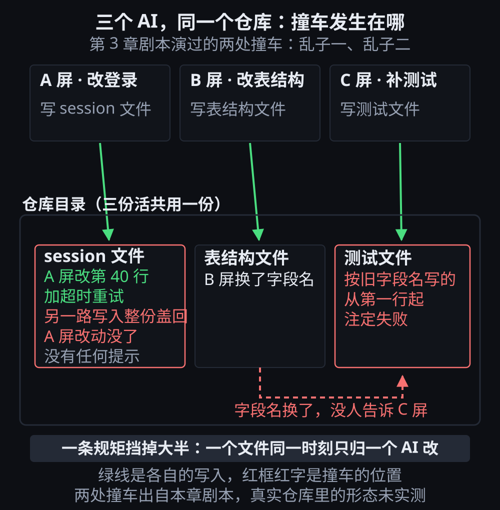

# 第 3 章 · 三个 AI 代理同时修改同一个仓库会产生的故障

> © 2026 xiaomijituan · 正文 CC BY 4.0，代码与数据 MIT · 原仓库 https://github.com/xiaomijituan/agent-machine-room-handbook

**要点**：把一项工作拆给三个 AI 代理之前，你要先确定一条分工规则——**一个文件在同一时刻只由一个代理负责修改**。下面五种故障就是这条规则针对的东西；处置办法在第 5 章。

第 3 章只讲故障为什么发生，不讲怎么处置。想直接上手的，从第 5 章读起更省力。

## 场景设定

你把一项工作拆成三份，分别交给三个 AI 代理：第一份修改登录流程，第二份修改数据库表结构，第三份补充测试。这三份任务在剧本文件 `scenario.json` 里各有代号：`edit-login`（改登录流程）、`edit-schema`（改表结构）、`write-tests`（补测试）；本章后文用任务代号指代正在运行该任务的那块屏幕。三块屏摆好之后，接下来的二十分钟不需要任何操作，可以离开；回到屏幕前，至少会遇到下面五种故障中的两种。

五种故障的成立程度并不相同，引用之前先看这张表：

| 编号 | 故障                             | 依据                        | 成立程度                                     |
| ---- | -------------------------------- | --------------------------- | -------------------------------------------- |
| 一   | 后写入的内容覆盖先写入的内容     | 剧本里 `edit-login` 的台词  | 剧本内成立；真实仓库里是否如此，未在本机复现 |
| 二   | 等待产物的一方拿到已被改动的产物 | 剧本里 `edit-schema` 的台词 | 同上                                         |
| 三   | 发给某个代理的话被另一个代理接走 | 派发规则有实现和单元测试    | 规则层面成立                                 |
| 四   | 整件事的进度没有人掌握           | 经验描述                    | 剧本里没有做成卡点，只能当作值得留心的现象   |
| 五   | 屏幕与任务的对应关系被遗忘       | 经验描述                    | 同上                                         |

## 第一种故障：后写入的内容覆盖先写入的内容

两块屏幕修改同一个文件。其中一块把该文件第 40 行改成带超时重试的写法；另一块不知道这一处改动，按自己开始工作时读到的那份内容整份写回。结果是第一块的改动消失，而且没有任何提示。

模拟器里这一幕依次给出三句提示：第一句报告"修改了 session 文件的第 40 行，加入超时重试"；第二句报告"这个文件现在已经不是 40 行的结构了"；第三句报告"另一块屏幕也修改过这个文件，本次改动覆盖了那一次的改动"。

成因在于写入单位。每个代理开始工作时读到一份完整的文件内容，工作结束时交回的也是**整份内容**，而不是"修改了哪几行"这样的差异描述。两份完整内容先后写回同一个文件时，后写入的那一份会覆盖前一份里的全部改动。

当场可以做的处置：同一个文件一次只允许一个代理修改；两个代理都要修改这个文件时排队执行。更完整的处置办法在第 5 章。

## 第二种故障：等待产物的一方拿到已被改动的产物

运行 `edit-schema` 的那个代理修改了表结构，字段名随之改变。此刻运行 `write-tests` 的那个代理正在按照修改前的字段名编写测试。这些测试从写下的第一行起就无法通过。

这类故障的特征是**发生故障的位置与做出决定的位置不是同一处**：测试失败显示在 `write-tests` 那块屏幕上，造成失败的改动在 `edit-schema` 那块屏幕上。你只检查显示失败的那块屏幕，会找不到原因。

下面这张图给出两处撞车的位置——第一块屏幕改动的第 40 行被同一文件的另一路写入整份覆盖；`edit-schema` 换掉的字段名让 `write-tests` 的测试从第一行起就无法通过：

当场可以做的处置：任何一个代理修改了会被其他代理依赖的内容，修改之前先通知依赖方，再动手。这一条不是礼节性的提醒——提前通知可以让依赖方省下一轮已经注定失败的测试运行。

## 第三种故障：发给一个代理的话被另一个代理接走

三块屏幕都在运行。你在当前屏幕上输入一行指令，按下回车键。**接住这句话的是状态为"空闲"或"已完成"的那块屏幕**，不一定是原本想给的那一块。

模拟器的派发规则写在实现里：只有状态是"空闲"或"已完成"的屏幕能接新任务，正在运行的屏幕接不了。目标屏幕正在运行时，这句话落到了旁边那块空闲的屏幕上。

**屏幕不会主动提醒这件事**——界面上没有任何一句"这句话被别的屏幕接走了"。

当场可以做的处置：派完任务立刻看一眼那块屏幕的任务名称有没有变化。派错了就重新派发一次；模拟器不会纠正派发错了这件事。

## 第四种故障：三块屏幕都报告"完成"，整件事的进度没有人掌握

每个代理只知道分给自己的那一份。三份都报告做完了，而这三份合起来是不是原本想要的那件事，**没有任何一个代理知道**。

当场可以做的处置：整件事的进度由人负责。把三份活合起来看的那一步判断，不能交给任何一块屏幕。

## 第五种故障：切了三块屏幕，回来已经说不清哪块在做什么

这一种与 AI 无关，是人的记忆容量问题。切过去、切回来、再看别的，二十分钟后手里有三块屏幕和三个"进行中"，但说不清哪块屏幕对应哪件事。

第 1 章讲的会话命名就是为解决这一种故障准备的：一块屏幕一个名字，名字里写清楚是谁的任务。

**证据的分寸**：第四、第五两种只有经验描述，剧本里没有对应的卡点；第一、第二两种在剧本台词里演过，但在真实仓库里是否如此没有在本机复现；只有第三种有实现和单元测试直接支撑。第一、第二、第四、第五种可以当作值得留心的现象引用，不能当作测量出来的结论引用。

## 国内多出来的一层麻烦：取包慢

前五种故障与网络无关，在模拟器里演得出来。国内多出来的是取包速度这件事。

三个 AI 各自安装依赖，就是几百个请求发往同一个软件源。**我们测量过一次**：同一个包，官方源串行三次是 2.01 / 1.05 / 0.94 秒，并发三次是 0.96 / 1.29 / 2.55 秒；国内镜像串行 0.047～0.081 秒，并发 0.073～0.081 秒。

这两组数字说明两件事：

- **慢的是官方源本身，不是"三个请求抢同一个出口"**。并发时最长 2.55 秒，串行时最长也有 2.01 秒；这点差值落在单次抖动范围内，**得不出"三个请求互相拖慢"这个结论**。最初的猜测是三个 AI 会挤同一个出口，实测没有支持这个猜测，所以这一条不写成结论。
- **镜像比官方源快一个数量级，而且更稳定**。这是本章唯一能给的操作性建议：安装依赖之前先确认软件源指向哪里。

原始输出在 `evidence/registry-fetch-timing.md`。那份文件里也写清了本次测量的局限：**只测了一个很小的文件、一次会话、一台机器。** 真正安装一次依赖是几百个请求、几十兆数据，结论可能不同。

## 如何自行复现

在模拟器里运行这一章的剧本（`scenario.json`），从五种故障里挑两种故意触发：

1. 让两块屏幕同时修改同一个文件，看第 40 行那次报告怎么出现。
2. 派任务时故意派给正在运行的那块屏幕，看这句话被谁接住。

跑完导出记录，与书里那份 `reference.jsonl` 并排比较，看第一个差别出现在第几步。**这是比对，不是打分。**

## 三句话带走

1. **一个文件在同一时刻只由一个代理修改。** 这一条能避开第一种和第二种故障的大半。
2. **修改了别人依赖的内容，先通知再动手。** 通知省下的是依赖方那一轮注定失败的运行。
3. **三份"完成"不等于一件事完成。** 把三份活合起来看的那一步判断，不能交给任何一块屏幕。

---

### 本章的证据与记录

`verify.md` 写清了哪些是模拟器里演过的、哪些是本机测量过的、哪些没有测到。原始输出在 `evidence/`。

### 一句提醒

不要把模拟器放在看不见的标签页里：浏览器会给后台标签页限速，实测三分钟只推进 6 拍。
