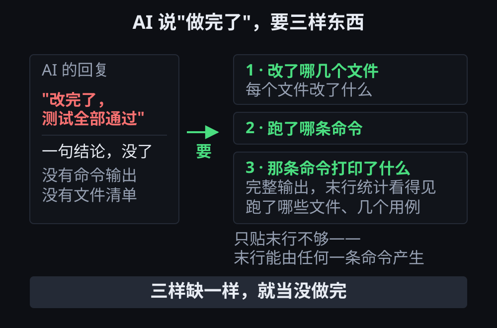

# 第 4 章 · AI 声称完成时，用三样证据确认真实改动

> © 2026 xiaomijituan · 正文 CC BY 4.0，代码与数据 MIT · 原仓库 https://github.com/xiaomijituan/agent-machine-room-handbook

**要点**：AI 交回一句"已完成，测试全绿"，你要索取三样东西——**改了哪些文件、跑了哪条命令、那条命令打印了什么**。三样缺一样，就当没做完。

本章要练的是"读输出"这件事本身：被读到的"输出"如果只有结论，就没有可供核对的内容。

## 场景设定

你交代了一句"把登录那块改一下，测试别挂"，二十分钟后收到 AI 的回复：**"改完了，测试全部通过。"**

你手上现在只有一个信息：AI 说通过了。**没有一条命令的输出，没有一份文件清单。**

这时候有两种做法：第一种是信，直接合进去，让改动的问题在没人盯着的时候暴露；第二种是先要证据。下面依次讲如何索取证据、如何阅读证据，以及如何避免被自己的想当然骗。

## 要证据的三件套

下面这一段要求可以直接使用：

```
把这三样给我：
1) 改了哪几个文件，每个文件改了什么（一句话一个文件）
2) 你跑了哪条命令
3) 那条命令的完整输出，末行的统计数字要看得见
```

**为什么第 3 条要"完整"**：只贴末行"12 passed"不够。末行可以由任何一条命令产生，包括跑错目标的那一条。完整输出要能看见那条命令跑的是哪些文件、几个用例。

验收标准只有一句话：AI 说做完了不算交付，三样证据齐了才算。下面这张图要看的是左边那份回复缺了什么——
没有命令输出，也没有文件清单；右边才是一次合格的交付：



## 读证据的时候，先找不一致

模拟器里的一幕：AI 贴了命令输出，末行写"12 个用例通过"，可 AI 在回复前面说改了**两个**文件，输出里只出现**一个**文件名。用例总数跟仓库里的测试文件数量也对不上。

**证据之间的不一致是最有价值的信号**：三个数字对不上，比 AI 明确说自己失败了还值得停下来核查。

建议按下面的顺序排查：

1. **先核对文件清单**（`git status` 或 `git diff --name-only`）。文件都不对，后面的输出别看。
2. **自己重跑那条命令**。这条最便宜，也最可靠。
3. 数字仍然对不上，别合。这不是"AI 粗心"的问题，是你不知道那份输出是哪条命令跑出来的。

## 一个真实的教训：我读错过一行警告

最该被记住的部分不是 AI，而是我自己——我读错过一行警告。

我们这台 Windows 机器上，提交文件时会打出这句话：

```
warning: LF will be replaced by CRLF in crlf-demo.txt.
The file will have its original line endings in your working directory
```

看到"会被换成 CRLF"（CRLF 是 Windows 文件每行末尾的回车加换行两个字符，LF 是 Linux 与 macOS 只带换行的写法），我的第一反应是：**"我这台机器上的文件都是 Windows 换行符了。"**

**这句推断是错的。** 查 `crlf-demo.txt` 自己的行尾：

```
$ git ls-files --eol crlf-demo.txt
i/lf    w/lf    attr/                   crlf-demo.txt
```

工作区（代码改动先落在其中、尚未存档进仓库的那个目录）里 `crlf-demo.txt` **仍然是 LF**，仓库里也是 LF。第二行警告已经把话说清了："你工作区里保持原样"。

更能说明问题的是：同一个仓库、同一台机器、同一个设置下，三个文件的行尾并不一样：

```
$ git ls-files --eol -- AGENTS.md CONTEXT.md README.md
i/lf    w/crlf  attr/                   AGENTS.md
i/lf    w/lf    attr/                   CONTEXT.md
i/lf    w/lf    attr/                   README.md
```

**`AGENTS.md` 的工作区是 CRLF，另外两个是 LF。** 所以"我这台机器都是 CRLF"这句话，被同一台机器上的输出直接否掉了。

**这一条对读 AI 证据有什么用**：如果我不查 `crlf-demo.txt` 的真实行尾，我就会把一个不存在的问题写给 AI，让 AI 去"修一个不是问题的东西"。**读别人的输出之前，先确认你引用的那句话到底在说什么。**

## 行尾设置在什么情况下会造成故障

把日志或文件内容复制给 AI 的时候，行尾不一致会造成三件看起来像 AI 出错的事：

1. AI 按行匹配文本，带回车字符的行匹配不上
2. shell 脚本带着回车在 Linux 上运行，报 `bad interpreter: /bin/bash^M`
3. 两份"内容一样"的文件，用 diff（比较两份文件差异的工具）看每一行都不同

**三种情况都不是 AI 本身出了错。** 判法只有一条：先查文件的真实行尾（`git ls-files --eol <文件>`），再决定该怀疑哪一环。

上面第 2、3 条我们在别处见过、这次**没有在本机复现**，所以只列现象，不当结论用。

## 如何让"带证据交付"变成默认

派发任务的那句话里就写清验收方式。下面这一段可以直接抄用：

```
改完后给我：改动的文件清单、你跑的命令、该命令的完整输出。
把完整输出同时写进 build.log，并告诉我文件路径。
```

**为什么要写进文件**：贴在回复里的输出会被截、会被复制时丢行。落到文件里，你随时能自己再看一遍，AI 也不能事后改口径。

模拟器里的那一局就是这样派发的（见 `reference.jsonl`）。

## 如何自行复现

在模拟器里运行这一章的剧本（`scenario.json`），三个卡点依次是：只有结论没有证据 / 贴了输出但数字不一致 / 空屏可以要求带日志重跑。

**故意先选一次"信它，直接合进去"**，再选一次"要三样证据"，导出两份记录，与书里那份 `reference.jsonl` 并排比较，看第一个差别出现在第几步。**这是比对，不是打分。**

---

### 本章的证据与记录

`verify.md` 分清了哪些是本机真跑的输出、哪些是剧本里的浓缩、哪些**没复现**。原始输出在 `evidence/line-endings.md`。

### 一句提醒

别把模拟器挂在后台标签页——浏览器会限速看不见的页面，实测三分钟只推进 6 拍。
