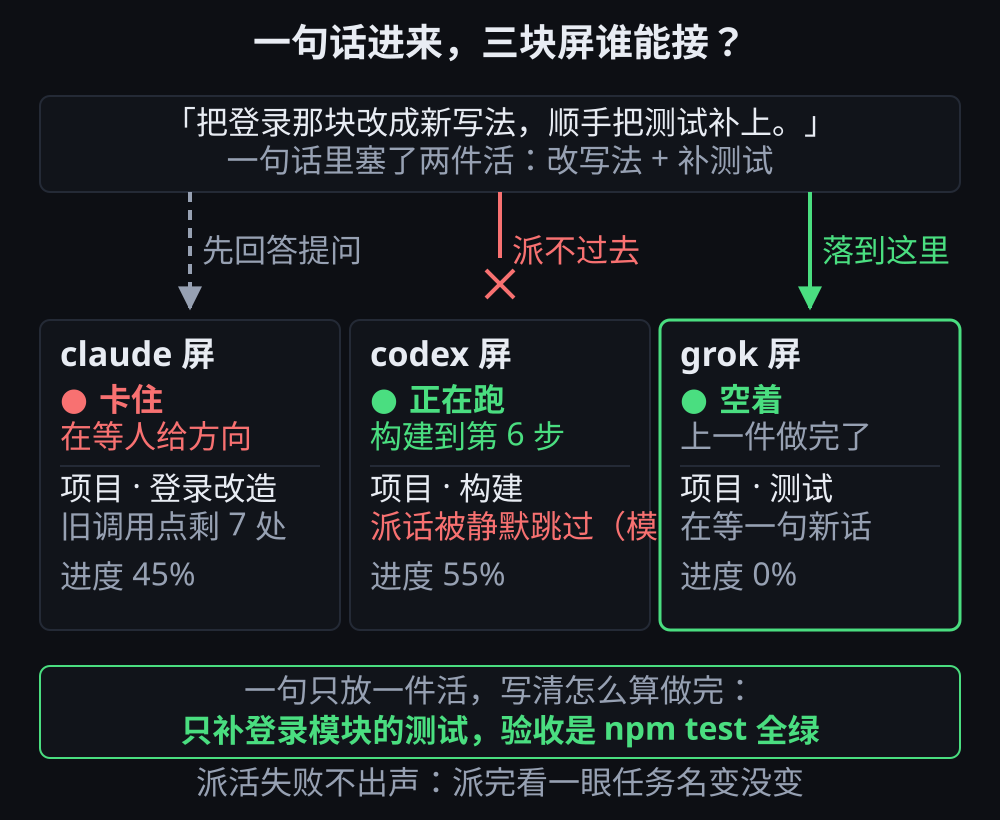

# 第 5 章 · 三块屏都停着，你只有一句话

> © 2026 xiaomijituan · 正文 CC BY 4.0，代码与数据 MIT · 原仓库 https://github.com/xiaomijituan/agent-machine-room-handbook

**要点**：派活之前，你要先看清每块屏的状态——**只有空闲或已完成的屏能接新活**；正在运行的屏接不住任何派发。

第 3 章讲的是三种故障怎么发生，这一章讲的是其中最常用的一条处置办法：话要给对的人。

## 场景设定

三块屏：一块卡住，在等你给方向；一块正在跑构建的第 6 步；一块空着。

手上有**一句话**：「把登录那块改成新写法，同时把测试补上。」

接下来要决定的是两件事：**这句话给谁**，以及**这句话要不要拆开**。

判断标准只有一条：派活之前，先确认哪块屏接得住这句话。下面这张图给出三条去路的差别——卡住的屏先回答提问，正在跑的屏会把派过去的话静默跳过（模拟器规则，指不作提示、也不写进记录），只有空着的那块屏能让这句话落下去：



## 三条判断

### 一、能接住派发的屏

模拟器里的规则是写死的；作者据此认为模拟器的这套规则贴近真实工具的用法（真实工具在这件事上怎么表现，没有测，见 `verify.md`）：

- **空闲的屏**能接，优先派给空闲的屏。
- **已完成的屏**能接，排在空闲的屏之后。
- **正在跑的屏接不了**。一块可接活的屏都没有时，这次派发会被拒绝。

所以，出现"我刚才明明说了，为什么没动"这类疑问时，最常见的原因不在模型本身，而在派发对象选错了：这句话发给了一块正在跑的屏，或者当时没有任何一块屏处于可接活的状态。

**派完一定要看一眼**：那块屏的任务名变了吗？没变就是没接住。重派一次就行，模拟器不会自己纠正派错这件事。

**这一条不是猜测，是我们在模拟器里试过的。** 在模拟器里回答完一块屏、又把第一句派给空着的那块之后，三块屏都在跑了。这时候再发第二句话："顺手把 CI 配置也改了"。结果是：**事件数一条没多，三块屏的任务名一个没变**——第二句话没有任何一块屏接住，记录里什么都没留下，既没有报错，也没有"被拒绝"那一行。

因此这一条要写成更明确的一句：**在模拟器里，派发失败不会留下任何提示，任务名是唯一的检查依据**。

### 二、一句话里只放一件活

「改登录，同时把测试补上」是两件事。真实项目里，AI 大概率只做第一件，把第二件当成附带说明忽略掉。

**依据要交代清楚**：这一条是经验，**我们没做成实验**（`verify.md` 的等级表里标着 C 级）。成本却极低：拆成两句，不拆最多损失一次重派。

拆完还有一层好处：第一件做完可以先验收（第 4 章讲的"要证据的三件套"），再派第二件。一句塞两件，中间没有任何可以插入检查的位置。

### 三、派完之后不要守着屏幕

这一点回到第 1 章：**屏是给 AI 干活用的，不是给人盯着看的**。守在屏幕前不会让进度变快，只会让人以为进度取决于自己有多专注。

派完之后，那块屏上正在发生什么，导出记录就能看见：每一步之前问了什么、选的是哪个回答、之后走到了哪一步。守着看，反而看不见这些。

## 派活那句话的写法

派活的那句话可以照下面这个模板写：

```
只改 <范围>，不要动 <别的地方>。
做完给我：改了哪些文件、跑了哪条命令、那条命令的完整输出。
跑不通就停下来告诉我卡在哪，不要改动其他文件。
```

**第三行的作用**：AI 卡住时常见的一种动作是"绕过去"——把检查注释掉、把测试跳过（这一条同样是经验，`verify.md` 里标着 C 级）。不提前写明禁止绕行，绕过去的结果同样会报"完成"。

**"不要动别的地方"这一行的作用**：这是第 3 章第一种故障和第二种故障的预防。范围收紧，两块屏修改到同一处内容的机会就小。

## 三块屏都卡住时的处理顺序

三块屏都在等人给方向时，按下面的顺序派发：

1. **先给挡住了别人的那一块**。其他屏在等这块屏的产物，等待产物一方所处的位置术语叫关键路径（整件事里最不容拖延的那条依赖链），对应的就是第 3 章第二种故障。
2. **再给能立刻接住的空闲屏**，让那块屏先跑起来——工作是并行推进的，空闲的屏放着最浪费。
3. **最后处理孤立的那一块**：只影响这块屏自己的任务，不会拖累其他屏。

判断"谁挡住了别人"的方法很直接：**问每块屏"你在等什么"**。模拟器里，等待产物的那块屏会直接回答"我在等另一块屏的结果"。

## 如何自行复现

在模拟器里运行本章剧本（`scenario.json`）：三块屏对应三种状态，手里只有一句话。三个卡点依次是这句话给谁、要不要拆开、派活的那句话怎么写。

**故意把话派给正在跑的那块屏试一次**，看它接不住、任务名不变——这就是"我说了为什么没动"的那一幕。

跑完导出记录，与 `reference.jsonl` 并排比较。**这是比对，不是打分。**

---

### 本章的证据与记录

哪几条是模拟器规则支撑的、哪几条只是经验，全写在 `verify.md` 那张表里。

### 一句提醒

不要把模拟器放在看不见的标签页里：浏览器会给后台标签页限速，实测三分钟只推进 6 拍。
