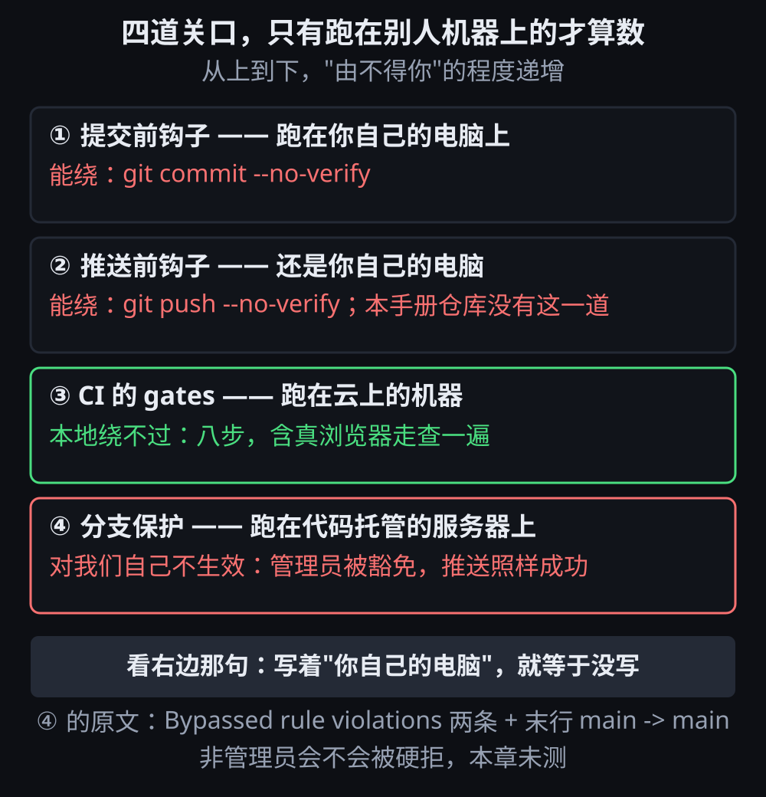

# 第 8 章 · 四道关口：让机器代替人工检查这四件事

© 2026 xiaomijituan · 正文 CC BY 4.0，代码与数据 MIT · 原仓库 https://github.com/xiaomijituan/agent-machine-room-handbook

> 第 4 章讲的是**人**如何向 AI 索取证据；本章把同一件事交给**机器**：四道关口，一道比一道难以
> 绕过，最后一道甚至不在你的电脑上。最后一道在我们自己的仓库里**没有生效**，生效范围与保留
> 原因，下文逐道说明。

## 术语：关口与钩子

**关口（门禁）**：一条命令；这条命令未通过，下一步就不会发生。**钩子（hook）**：Git 在提交或
推送之前自动执行的那条命令，配置写在 `.husky/` 这类目录里。下面的表按"跑在哪台机器上"排序，
位置越靠后，可绕过的余地越小：

| 关口   | 什么时候跑             | 跑在哪台机器上   | 我们仓库里实际跑的命令                                                                    | 能否绕过                                               |
| ------ | ---------------------- | ---------------- | ----------------------------------------------------------------------------------------- | ------------------------------------------------------ |
| 第一道 | `git commit` 之前      | 你自己的电脑     | 手册仓库：`npm run check` 加 `npx prettier --check .`；聚变仓库：`npx prettier --check .` | 可绕过：`git commit --no-verify`                       |
| 第二道 | `git push` 之前        | 你自己的电脑     | 聚变仓库：`npm run typecheck && npm run lint && npm run test`；**手册仓库没有这一道**     | 可绕过：`git push --no-verify`                         |
| 第三道 | 推上去之后             | 云上的 CI 机器   | 类型、静态检查、测试、构建、剧本校验、真浏览器走查，最后再拿发布产物跑一遍                | 本地无法绕过；这道检查只作用于已经推送的内容           |
| 第四道 | 服务器收到推送的那一刻 | 代码托管的服务器 | 分支保护：改 `main` 必须走拉取请求、CI 必须通过、禁止强推                                 | 见下文"第四道：服务端分支保护，以及一次没有生效的推送" |

**拉取请求（PR）**：把"希望把这些提交合进 `main`"当成一个请求发出去，其他评审人和 CI 都通过之后
才会合并。**强推（force push）**：用 `--force` 把远端的历史整体替换成本地版本，是抹掉他人已完成
工作最快的一种做法。

四道关口排在一起，关键只有一句话："关口越多越好"是错觉，**只有跑在别人机器上的那几道才算数**。
下面这张图要看的是每道关口右边那一栏——前两道写着"你自己的电脑"，等于没有设防。



## 第一道和第二道：都跑在自己的电脑上，因此都可以绕过

两个仓库的钩子内容不同，原文照录：

```
# 聚变（多 agent 模拟器）仓库
.husky/pre-commit:  npx prettier --ignore-unknown --check .
.husky/pre-push:    npm run typecheck && npm run lint && npm run test

# 本手册仓库
.husky/pre-commit:  npm run check
                    npx prettier --check .
.husky/pre-push:    （没有这一道）
```

手册仓库把内容检查放在提交前、把格式化也放在提交前，**没有推送前那一道**。理由写在提交历史里：
内容检查核对的是当前一章的五件文件是否齐全、身份信息涂改（掩码）有没有漏项，这些内容和格式化
一样，属于提交之前就应当保持干净的东西。

`--no-verify` 是 Git 自带的跳过开关，加上这一个参数，前两道就都不执行。正文**没有实测过真实的
绕过**；这是 Git 的公开行为，列出这一条是为了说清一件事：**前两道不是防线，是提醒**。

### 一次真实事故：钩子检查的是暂存内容，不是工作区里计划提交的内容

`git add` 之后又修改了同一个文件，提交进仓库的是**暂存区里那份旧内容**——钩子检查的对象同样是
暂存内容，所以钩子报告通过并没有出错。这起事故发生过一次：说明文字先 `git add` 了，随后又改了
一句，提交上去的仍是改动之前的那一句，只能再补一个提交。教训不是"钩子不可信"，而是**钩子无法
知道暂存之后你又做了哪些修改**。所以推送前那一道（跑在暂存之后）和 CI 那一道（跑在服务器上，
检查最终推上去的提交）不是重复劳动。

## 第三道：CI 的 `gates` 作业

两个仓库的 CI 作业都叫 `gates`。聚变仓库那份跑八步，原文照录：

```
npm ci → typecheck → lint → test → build → scenario:check
→ 装一个真浏览器 → 用真浏览器把生产构建点一遍（scripts/ci-qa.mjs）
→ 打出两个发布产物，并拿它们跑一遍
```

最后一步值得单独说明——这一步决定这道关口检查的对象是不是**真的**产物：

```yaml
- name: Bundle the release artifacts and run them like the handbook CI would
  # Last, because the projector is smoked on the .jsonl the walk just downloaded
  # (screenshots/qa-8-run.jsonl) — real app output beats a hand-written fixture.
```

这段注释翻译成中文是：投影器（把运行记录变成复盘表的工具）的输入，是**上一步浏览器走查刚刚
下载下来的那份真实记录**，不是手写样例。手写样例只能证明"设想过的情况能通过"，真实记录才能
证明"应用确实产出了同样的输出形状"。

还有一处与直觉相反的配置，注释原文照录：

```yaml
jobs:
  gates:
    # 钉死镜像，不用 ubuntu-latest：latest 从 2026-10-19 起从 Ubuntu 24.04 换成 26.04，
    # 而我们脚下的机器不该在没人决定的那天自己换。CI 里的 playwright --with-deps chromium
    # 装的是系统依赖，最容易随镜像变。要跟迁的那一天，单独开一次验证再改这里。
    runs-on: ubuntu-24.04
```

`ubuntu-latest` 意味着"跟着别人走"，`ubuntu-24.04` 意味着"停在我决定的那天"。走查依赖浏览器
安装的系统包，更换镜像的当天正是失败风险最高的一天。**把"最新"钉死不是保守，是让失败发生在
一个有人负责的日子。**

## 第四道：服务端分支保护，以及一次没有生效的推送

这道关口跑在 GitHub 服务器上，本地的任何开关都影响不到。规则配置了三条：改 `main` 必须走
拉取请求、CI 的状态检查必须通过、禁止强推与删除 `main`。

下面是一次真实推送的原文输出（2026-10-06，仓库是聚变）：

```
remote: Bypassed rule violations for refs/heads/main:
remote:
remote: - Changes must be made through a pull request.
remote:
remote: - Required status check "gates" is expected.
remote:
To https://github.com/xiaomijituan/fusion.git
   e7b5da3..b15c086  main -> main
```

**看最后一行：`e7b5da3..b15c086  main -> main`——推送成功了。** `Bypassed rule violations` 的意思
不是"违规被拦下"，而是"**这些违规被绕过了**"。绕过规则的人是管理员，而规则把管理员设为豁免。

所以本章最该被记住的一条是：**我们配置的第四道关口，对我们自己不生效。** 为什么仍然保留？
两个理由写在正文里，不藏在配置里：

1. 单人项目里，这道关口的价值是**留痕**——每一次直接推送都会在推送输出里留下两条违规记录，
   每一次破例都有据可查。
2. 一旦出现第二个协作者（或者未来的管理员换了一个账号），分支保护立刻对新成员生效，
   不需要临时调整配置。

**没有测量到的**：非管理员的直接推送会不会被硬拒。测试用的账号只有管理员一个，所以这一条只能
标记为"未测"——"配置了规则"不等于"这道检查拦得住"。

## 两起门禁自身引发的真实故障

被设置好的关口本身也会造成功能故障，下面两起都真实发生过：

- **格式化工具改动了必须逐字节一致的文件。** 手册仓库里放着一份从聚变发布页复制来的模拟器
  （即 `vendor/` 目录里的那份），需要核对文件大小和校验和。执行一次 `prettier --write .` 之后，
  那份文件从 `404364` 字节变成 `825718` 字节——内容没有变化，全部被重新排版，校验和对不上。
  处置办法是在 `.prettierignore` 里写明忽略的原因，而不只写一条忽略规则。
- **换行符转换让"同一份文件"在两台机器上不再是同一串字节。** 本机配置了 `core.autocrlf=true`，
  检出时 LF 变成 CRLF，于是下载回来的字节和仓库里的字节不一样，MD5 必然对不上。处置办法是在
  `.gitattributes` 中对需要逐字节一致的文件写明 `-text`（不参与换行符改写），注释连同原因一起
  提交。

两起故障的共同教训：**门禁检查的输入，必须是你真正要交付的内容**。格式化会修改输入，换行符
转换也会修改输入，输入一旦被改动，"通过检查"与"实际内容"就会分家。

## 没有测量到的部分

1. 用 `--no-verify` 真实绕过前两道：没有做过实验，属于对 Git 公开行为的陈述。
2. 非管理员被第四道硬拒：没有第二个账号，未测。
3. 是否关闭管理员豁免：这是取舍，不是技术问题——关闭之后，每一次单人小改动都要发起拉取请求
   并等待 CI。我们的选择是"保留豁免，靠推送输出里 `Bypassed` 开头的两行留痕"，**没有对比过
   另一种配置的实际代价**。

## 本章的三块屏

三块屏分别停在第一道、第三道、第四道关口前。剧本在 [`scenario.json`](./scenario.json)，
一局真实跑出来的记录在 [`reference.jsonl`](./reference.jsonl)——这一局的记录来自模拟器导出按钮
**真实下载落盘**的文件，与前七章从浏览器内部存储读回来的做法不同，证据等级见
[`verify.md`](./verify.md)。国内网络环境下的额外差异见 [`china.md`](./china.md)。
